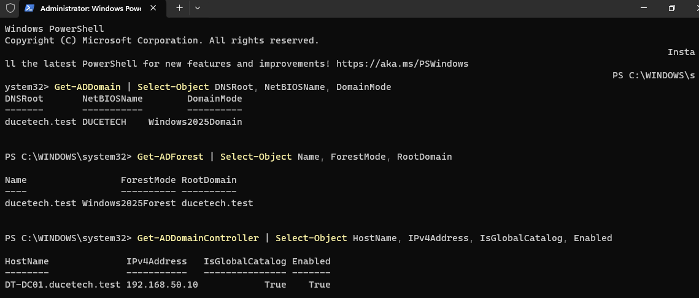
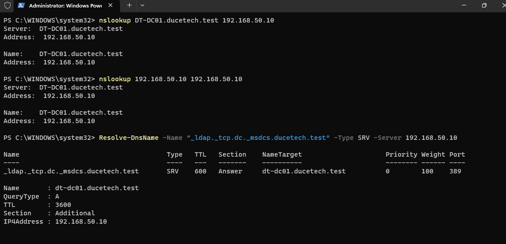
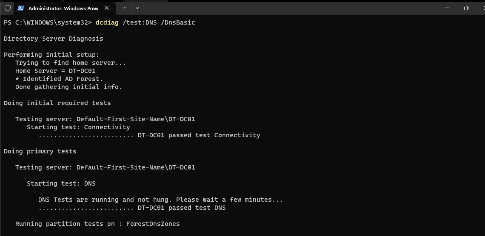
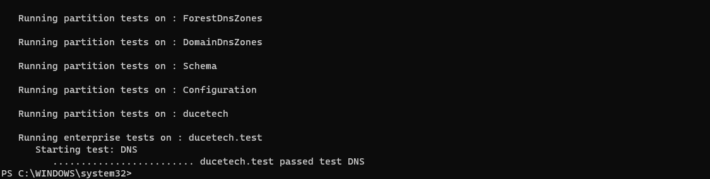

# Phase 01 — PowerShell & Diagnostic Command Reference

## Overview

This document records administrative and diagnostic commands used during the deployment, configuration, and validation of the DuceTech enterprise infrastructure environment.

## 1. System and Network Verification

| Command | Purpose | Result |
|---|---|---|
| `hostname` | Verify server hostname | DT-DC01 |
| `ipconfig /all` | Inspect detailed network configuration | Static IPv4 configuration verified |

## 2. Active Directory Verification

| Command | Purpose | Result |
|---|---|---|
| `Get-ADDomain` | Retrieve domain configuration | ducetech.test verified |
| `Get-ADForest` | Retrieve forest configuration | Windows Server 2025 forest verified |
| `Get-ADDomainController` | Retrieve domain controller information | DT-DC01 enabled and operational |

### Filtered PowerShell Output

```powershell
Get-ADDomain | Select-Object DNSRoot, NetBIOSName, DomainMode
```

```powershell
Get-ADForest | Select-Object Name, ForestMode, RootDomain
```

```powershell
Get-ADDomainController | Select-Object HostName, IPv4Address, IsGlobalCatalog, Enabled
```

These commands retrieve specific infrastructure properties for efficient administrative verification.

## 3. DNS Administration

### Inspect DNS Zones

```powershell
Get-DnsServerZone
```

**Purpose:** Identify configured forward and reverse lookup zones.

### Create PTR Record

```powershell
Add-DnsServerResourceRecordPtr -Name "10" -ZoneName "50.168.192.in-addr.arpa" -PtrDomainName "DT-DC01.ducetech.test."
```

**Purpose:** Create a reverse DNS record associating the server's IPv4 address with its fully qualified domain name.

**Result:** PTR record successfully created and verified.

## 4. DNS Resolution Testing

### Forward Lookup

```powershell
nslookup DT-DC01.ducetech.test 192.168.50.10
```

**Result:** Successfully resolved to 192.168.50.10.

### Reverse Lookup

```powershell
nslookup 192.168.50.10 192.168.50.10
```

**Result:** Successfully resolved to DT-DC01.ducetech.test.

### Domain Controller Discovery

```powershell
Resolve-DnsName -Name "_ldap._tcp.dc._msdcs.ducetech.test" -Type SRV -Server 192.168.50.10
```

**Result:** Successfully retrieved the LDAP SRV record identifying DT-DC01 on port 389.

## 5. Domain Controller Health Diagnostics

### Comprehensive Diagnostic Test

```powershell
dcdiag /v
```

**Purpose:** Evaluate domain controller functionality and identify recorded infrastructure errors.

**Result:** Core Active Directory functionality verified. DFSREvent and SystemLog tests reported errors requiring additional investigation.

### Basic DNS Diagnostic Test

```powershell
dcdiag /test:DNS /DnsBasic
```

**Result:** Domain controller connectivity, server DNS, and enterprise DNS tests passed.

### DFS Replication State Verification

```powershell
Get-CimInstance -Namespace root\MicrosoftDFS -ClassName DfsrReplicatedFolderInfo | Select-Object ReplicatedFolderName, State
```

**Result:**

| Replicated Folder | State |
|---|---|
| SYSVOL Share | 4 - Normal |

Current local SYSVOL replication folder state was verified. Replication between multiple domain controllers was not tested because the environment contains a single domain controller.

## 6. Command Classification

| Command | Classification |
|---|---|
| hostname | System verification |
| ipconfig /all | Network diagnostics |
| Get-ADDomain | Directory verification |
| Get-ADForest | Directory verification |
| Get-ADDomainController | Infrastructure verification |
| Get-DnsServerZone | DNS inspection |
| Add-DnsServerResourceRecordPtr | Configuration change |
| nslookup | DNS diagnostics |
| Resolve-DnsName | DNS diagnostics |
| dcdiag | Infrastructure diagnostics |
| Get-CimInstance | System state inspection |

## Technical Skills Demonstrated

- PowerShell command-line administration
- Active Directory configuration verification
- Windows network diagnostics
- DNS record management
- Domain controller health assessment
- Structured diagnostic testing
- Technical documentation

## Related Documentation

- [Phase 01 Implementation](README.md)
- [Technical Troubleshooting Report](Troubleshooting.md)

## Supporting Evidence








