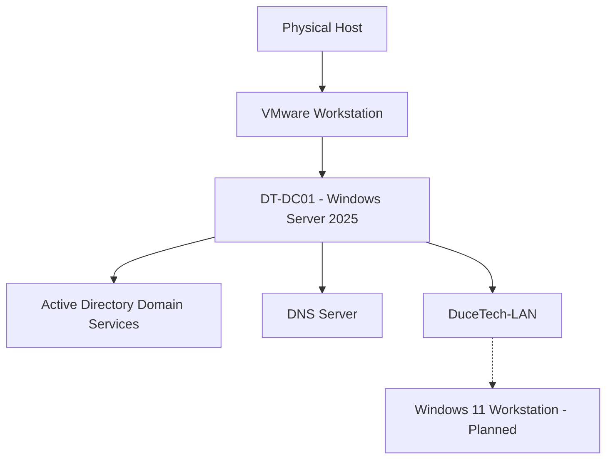

# Phase 01 — Windows Server, Active Directory & DNS Deployment

## Project Overview

Designed and deployed the foundational infrastructure for a virtual enterprise IT environment using VMware Workstation and Windows Server 2025.

This project establishes a centralized domain environment designed to support 50 employee accounts, departmental access management, workstation administration, Group Policy, and enterprise IT troubleshooting.

## Project Objectives

- Deploy and configure Windows Server 2025.
- Establish an isolated enterprise network.
- Configure static IPv4 addressing.
- Install Active Directory Domain Services (AD DS).
- Create an Active Directory forest and domain.
- Promote Windows Server to a domain controller.
- Configure and validate DNS services.
- Troubleshoot infrastructure and configuration issues.
- Perform domain controller health diagnostics.
- Establish a virtual machine recovery checkpoint.

## Technologies & Tools

| Technology | Purpose |
|---|---|
| VMware Workstation | Virtual infrastructure management |
| Windows Server 2025 | Enterprise server operating system |
| Active Directory Domain Services | Centralized identity management |
| DNS Manager | DNS administration |
| Server Manager | Server role installation and management |
| PowerShell | Administrative configuration and diagnostics |
| DCDiag | Domain controller health assessment |
| VMware Snapshots | Configuration recovery checkpoints |

## Infrastructure Specifications

| Component | Configuration |
|---|---|
| Server hostname | DT-DC01 |
| Operating system | Windows Server 2025 Standard Evaluation |
| Memory | 4 GB |
| Virtual CPU cores | 2 |
| Virtual disk | 60 GB |
| Forest | ducetech.test |
| Domain | ducetech.test |
| NetBIOS domain | DUCETECH |
| Functional level | Windows Server 2025 |
| Network segment | DuceTech-LAN |

## Network Configuration

| Setting | Value |
|---|---|
| IPv4 address | 192.168.50.10 |
| Subnet mask | 255.255.255.0 |
| Network address | 192.168.50.0/24 |
| Preferred DNS | 192.168.50.10 |
| Default gateway | None |
| Address assignment | Static |
| Network adapter | Isolated LAN segment |

The domain controller was assigned a static IP address to maintain consistent availability for future domain-joined workstations and internal DNS services.

The network was intentionally isolated from external networks to provide a controlled environment for administrative and troubleshooting exercises.

## Network Architecture

## Network Architecture

## Implementation Process

### 1. Virtual Server Deployment

- Created a dedicated Windows Server virtual machine.
- Allocated virtual CPU, memory, and storage resources.
- Installed Windows Server 2025 Standard Evaluation with Desktop Experience.
- Installed VMware Tools.
- Configured the isolated virtual network.

### 2. Server Configuration

- Renamed the server to DT-DC01.
- Configured static IPv4 addressing.
- Configured the server to use its own IP address for DNS.
- Verified network configuration using command-line utilities.

### 3. Active Directory Deployment

- Installed the Active Directory Domain Services server role.
- Created a new forest and root domain named ducetech.test.
- Promoted DT-DC01 to a domain controller.
- Configured DNS and Global Catalog functionality.
- Verified domain, forest, and domain controller properties.
- Confirmed assignment of all five FSMO roles to DT-DC01.

### 4. DNS Configuration

- Verified Active Directory-integrated forward lookup zones.
- Created an IPv4 reverse lookup zone.
- Created a PTR record using PowerShell.
- Verified forward and reverse DNS resolution.
- Validated LDAP service discovery through DNS SRV records.

## Troubleshooting Experience

| Issue | Investigation and Resolution |
|---|---|
| VMware clipboard malfunction | Investigated VMware Tools, Guest Isolation settings, and service status. Clipboard functionality was restored, although the exact cause was not confirmed. |
| Incorrect APIPA address displayed in Server Manager | Verified the actual IPv4 configuration using ipconfig /all and refreshed Server Manager to display the correct address. |
| DNS server displayed as Unknown | Investigated DNS zones, configured reverse lookup functionality, and verified IPv4 DNS resolution. |
| PTR record creation unavailable through GUI | Used PowerShell to successfully create the required PTR record. |
| DFS Replication diagnostic warnings | Reviewed historical errors and verified that the current SYSVOL replication folder state was normal. |

## Validation & Testing

| Validation Test | Result |
|---|---|
| Domain controller connectivity | Passed |
| Active Directory domain verification | Passed |
| Active Directory forest verification | Passed |
| Global Catalog verification | Confirmed |
| Forward DNS resolution | Passed |
| Reverse DNS resolution | Passed |
| LDAP SRV record verification | Passed |
| SYSVOL and NETLOGON availability | Passed |
| Current DFSR folder state | Normal - State 4 |
| Basic DNS diagnostics | Passed |

Detailed domain controller diagnostics identified historical DFS Replication and System Log errors. Subsequent checks confirmed normal current SYSVOL folder state and successful basic DNS diagnostics.

Historical warnings were retained for further investigation rather than cleared or represented as fully resolved.

## Recovery & Change Management

Created a VMware recovery snapshot following successful infrastructure deployment and DNS validation.

Snapshot name:

DT-DC01-Phase01-AD-DNS-Verified

This checkpoint provides a recovery option before introducing additional workstations, user accounts, and administrative configurations.

## Skills Demonstrated

- Windows Server administration
- Virtual machine deployment
- TCP/IP network configuration
- Active Directory infrastructure deployment
- DNS administration and troubleshooting
- PowerShell administration
- System diagnostics
- Technical problem-solving
- Infrastructure documentation
- Configuration recovery management

## Lessons Learned

- Active Directory depends heavily on properly configured DNS.
- Administrative interfaces may display outdated information, making command-line verification valuable.
- PowerShell provides alternative administrative methods when graphical tools are unavailable.
- Historical diagnostic errors should be evaluated alongside current system health.
- Successful configuration should always be followed by functional verification.
- Recovery checkpoints are valuable before implementing additional infrastructure changes.

## Outstanding Tasks

- Windows Server activation and updates.
- External time synchronization configuration.
- Further review of historical diagnostic warnings.
- Windows 11 client connectivity and domain authentication testing.

## Next Phase

Phase 02 will focus on Windows 11 workstation integration, domain membership, employee account creation, and authentication testing.

---

**Project Status:** Phase 01 deployment completed and core internal infrastructure verified.
