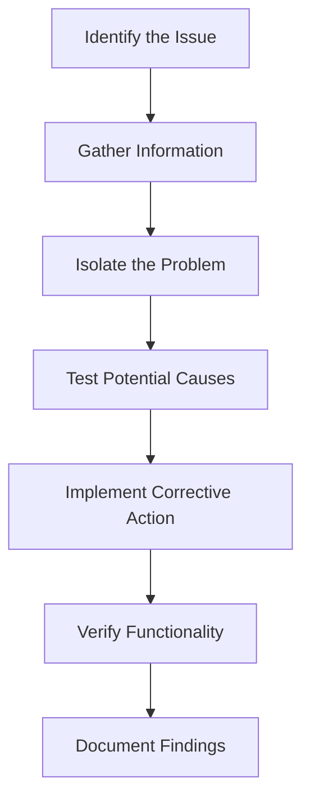

# Phase 01 — Technical Troubleshooting Report

## Overview

This report documents technical issues encountered during the deployment of the DuceTech enterprise infrastructure environment. Each incident demonstrates systematic troubleshooting, diagnostic testing, corrective action, and resolution verification.

## Incident 01 — VMware Clipboard Integration

**Category:** Virtualization / Desktop Support

**Issue:**  
Copy-and-paste functionality between the physical host and Windows Server virtual machine was unavailable.

**Investigation:**
- Verified VMware Tools installation.
- Reviewed VMware Guest Isolation settings.
- Inspected the VMware Tools service.
- Confirmed the service was running with an automatic startup configuration.

**Findings:**  
VMware Tools was installed and operational. The exact cause of the temporary clipboard failure was not conclusively identified.

**Resolution:**  
Clipboard functionality became available following configuration and service verification.

**Verification:**  
Successfully copied and pasted text between the host and virtual machine.

**Status:** Resolved — root cause unconfirmed.

---

## Incident 02 — Incorrect IP Address Displayed in Server Manager

**Category:** Network Configuration

**Issue:**  
Server Manager displayed an APIPA address (169.254.235.32) despite the server being configured with a static IPv4 address.

**Investigation:**
- Executed `ipconfig /all`.
- Verified the configured IPv4 address and subnet mask.
- Confirmed DHCP was disabled.
- Compared command-line results against Server Manager.

**Findings:**  
The network adapter was correctly configured with 192.168.50.10. Server Manager was displaying outdated network information.

**Resolution:**  
Closed the role installation wizard and refreshed Server Manager.

**Verification:**  
Server Manager displayed the correct static IPv4 address.

**Status:** Resolved.

---

## Incident 03 — DNS Timeout and Unknown Server

**Category:** DNS Administration

**Issue:**  
DNS queries returned the correct hostname and IPv4 address but displayed a timeout and identified the DNS server as Unknown.

**Investigation:**
- Executed forward DNS lookup tests.
- Queried the DNS server directly using its IPv4 address.
- Inspected existing DNS zones using PowerShell.
- Identified the absence of a reverse lookup zone for the configured subnet.

**Findings:**  
Forward DNS resolution was functional, but reverse DNS configuration was incomplete.

**Resolution:**
- Created an Active Directory-integrated reverse lookup zone.
- Configured secure dynamic updates.
- Created a PTR record for DT-DC01.

**Verification:**
- Successfully resolved the server hostname to 192.168.50.10.
- Successfully resolved 192.168.50.10 to DT-DC01.ducetech.test.
- Explicit IPv4 DNS queries completed without the previous timeout or Unknown server message.

**Status:** Resolved for explicit IPv4 DNS queries.

---

## Incident 04 — PTR Record Creation Unavailable in DNS Manager

**Category:** PowerShell / DNS Administration

**Issue:**  
The New Pointer (PTR) option was unavailable in the DNS Manager graphical interface.

**Investigation:**
- Confirmed the reverse lookup zone existed.
- Verified the correct DNS zone was selected.
- Reviewed available management options.

**Findings:**  
The graphical interface did not provide an available PTR creation option. The underlying cause was not conclusively identified.

**Resolution:**  
Used PowerShell to create the required DNS record:

```powershell
Add-DnsServerResourceRecordPtr -Name "10" -ZoneName "50.168.192.in-addr.arpa" -PtrDomainName "DT-DC01.ducetech.test."
```

**Verification:**  
Confirmed the PTR record appeared in DNS Manager and successfully performed a reverse DNS lookup.

**Status:** Resolved through an alternative administrative method.

---

## Incident 05 — Historical DFS Replication Errors

**Category:** Active Directory / Infrastructure Diagnostics

**Issue:**  
Domain controller diagnostics reported failures in the DFSREvent and SystemLog tests.

**Investigation:**
- Executed `dcdiag /v`.
- Reviewed reported DFS Replication and system events.
- Verified SYSVOL and NETLOGON availability.
- Queried the current DFS Replication folder state.
- Performed additional DNS diagnostics.

**Diagnostic Command:**

```powershell
Get-CimInstance -Namespace root\MicrosoftDFS -ClassName DfsrReplicatedFolderInfo | Select-Object ReplicatedFolderName, State
```

**Findings:**
- SYSVOL replication folder reported State 4 (Normal).
- SYSVOL and NETLOGON availability tests passed.
- Historical errors remained recorded in the event logs.
- Basic DNS diagnostics passed.

**Resolution:**  
Validated current SYSVOL and DNS functionality without making unnecessary infrastructure changes or clearing historical event logs.

**Status:** Current SYSVOL functionality verified. Historical errors retained for monitoring.

---

## Troubleshooting Methodology



## Technical Skills Demonstrated

- Systematic troubleshooting
- Windows Server administration
- VMware virtualization support
- IPv4 configuration validation
- DNS record administration
- PowerShell-based problem resolution
- Active Directory diagnostics
- Event log analysis
- Infrastructure health verification
- Technical documentation

## Supporting Evidence

Refer to the [Phase 01 Implementation Documentation](README.md) for screenshots, infrastructure specifications, and validation results.

## Lessons Learned

- Verify actual system configuration before making changes.
- Distinguish historical errors from current operational failures.
- Use command-line administration when graphical tools are unavailable.
- Confirm functionality after implementing corrective actions.
- Avoid assigning root causes without sufficient evidence.
- Preserve diagnostic information for future investigation.
