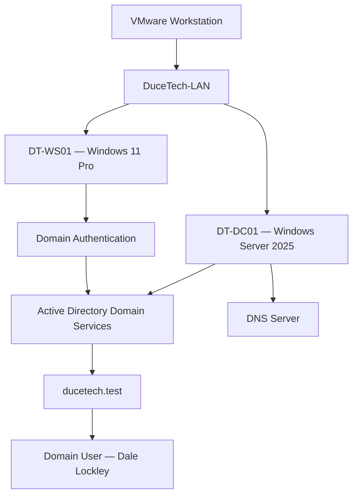

# Phase 02 — Workstation Deployment & Domain Integration

## Project Overview

This phase extends the DuceTech enterprise infrastructure by integrating a Windows 11 workstation into an existing Active Directory domain hosted on Windows Server 2025.

The objective was to establish centralized authentication, verify workstation-to-server communication, and demonstrate enterprise endpoint administration within a controlled virtual environment.

## Objectives

- Configure workstation IPv4 and DNS settings.
- Establish communication with the domain controller.
- Verify DNS resolution and domain controller discovery.
- Implement standardized workstation naming.
- Join a Windows 11 workstation to Active Directory.
- Verify computer object registration in AD DS.
- Provision and authenticate a domain user.
- Troubleshoot workstation and virtualization issues.
- Establish a recovery snapshot.

## Lab Environment

| Component | Configuration |
|---|---|
| Hypervisor | VMware Workstation |
| Server OS | Windows Server 2025 Standard |
| Client OS | Windows 11 Pro |
| Domain Controller | DT-DC01 |
| Workstation | DT-WS01 |
| Active Directory Domain | ducetech.test |
| NetBIOS Domain | DUCETECH |
| Network Segment | DuceTech-LAN |
| Network Subnet | 192.168.50.0/24 |
| Domain Controller IP | 192.168.50.10 |
| Workstation IP | 192.168.50.20 |
| DNS Server | 192.168.50.10 |
| Address Assignment | Static IPv4 |

## Network Architecture

## Implementation

### 1. Workstation Network Configuration

- Connected the Windows 11 virtual machine to the isolated DuceTech-LAN network segment.
- Assigned a static IPv4 address of 192.168.50.20.
- Configured a subnet mask of 255.255.255.0.
- Configured the domain controller as the workstation's primary DNS server.
- Verified network configuration using ipconfig.

The default gateway was intentionally left unconfigured because the lab operates on an isolated internal network.

### 2. Network Connectivity and DNS Verification

Verified communication between the workstation and domain controller using:

- ICMP connectivity testing.
- DNS hostname resolution.
- Active Directory domain controller discovery.

All workstation connectivity and domain discovery tests completed successfully.

### 3. Workstation Naming and Domain Integration

- Renamed the workstation from DuceTech to DT-WS01.
- Implemented a standardized enterprise naming convention.
- Joined DT-WS01 to the ducetech.test domain.
- Restarted the workstation to apply domain membership.
- Verified domain membership using PowerShell.
- Confirmed the workstation computer object in Active Directory Users and Computers.

### 4. Active Directory User Provisioning

Created the first standard domain user through Active Directory Users and Computers.

| Attribute | Value |
|---|---|
| Employee Name | Dale Lockley |
| Username | d.lockley |
| Domain Account | DUCETECH\d.lockley |
| User Principal Name | d.lockley@ducetech.test |
| Account Type | Standard Domain User |
| Password Change | Required at First Logon |

### 5. Centralized Authentication

- Authenticated using the newly provisioned domain account.
- Enforced the required password change at first logon.
- Verified domain password policy enforcement.
- Confirmed the creation of a separate Windows user profile.
- Verified the authenticated domain identity.
- Confirmed DT-DC01 as the authentication server.

## Technical Verification

| Verification Test | Result |
|---|---|
| Static IPv4 Configuration | Passed |
| Domain Controller Connectivity | Passed |
| DNS Hostname Resolution | Passed |
| Domain Controller Discovery | Passed |
| Workstation Domain Membership | Passed |
| AD Computer Object Registration | Passed |
| Domain User Provisioning | Passed |
| Password Policy Enforcement | Passed |
| Centralized Authentication | Passed |
| Authentication Server Verification | Passed |
| VMware Clipboard Functionality | Restored |
| Recovery Snapshot | Completed |

## Troubleshooting Experience

During implementation, several issues required investigation and resolution.

| Incident | Resolution |
|---|---|
| Workstation Naming Warning | Renamed workstation using standardized naming convention |
| Password Policy Rejection | Entered an acceptable password |
| VMware Host-to-Guest Clipboard Failure | Restarted workstation and verified restored functionality |

The clipboard issue provided an opportunity to investigate Windows user sessions, VMware Tools services, background processes, and guest integration settings.

The restart restored functionality, although the underlying root cause was not conclusively established.

A Windows security update also appeared stalled at 12%. Its final installation status remains unverified.

Detailed troubleshooting procedures are documented separately.

## Recovery and Change Management

Created a pre-deployment snapshot before modifying workstation network and domain settings.

Created a post-deployment recovery snapshot after successful domain integration and authentication verification.

**Recovery Snapshot:**

DT-WS01-Phase02-Domain-Join-Verified

These checkpoints provide recovery options and demonstrate controlled infrastructure change management.

## Skills Demonstrated

- Windows 11 Administration
- Windows Server 2025
- Active Directory Domain Services
- Active Directory Users and Computers
- Enterprise Endpoint Deployment
- Domain Joining
- DNS Configuration and Troubleshooting
- TCP/IP Networking
- Static IPv4 Configuration
- Identity and Access Management
- User Account Provisioning
- Centralized Authentication
- Password Policy Enforcement
- PowerShell Administration
- Windows User Session Troubleshooting
- VMware Workstation Administration
- Technical Documentation
- Infrastructure Change Management

## Key Takeaways

- Active Directory relies heavily on properly configured DNS.
- Domain controller discovery should be verified before attempting a domain join.
- Local accounts and domain accounts represent separate authentication identities.
- Domain membership does not automatically grant administrative privileges.
- Centralized password policies help enforce organizational security requirements.
- Troubleshooting should prioritize efficient, low-risk solutions before complex remediation.
- Recovery snapshots provide valuable rollback options during infrastructure changes.

## Supporting Documentation

- [Troubleshooting Documentation](Troubleshooting.md)
- [PowerShell and Command-Line Reference](PowerShell-Commands.md)

## Project Status

**Phase 02 — Technical Implementation Complete**

Next Phase: Organizational Unit Design and Enterprise User Provisioning.
