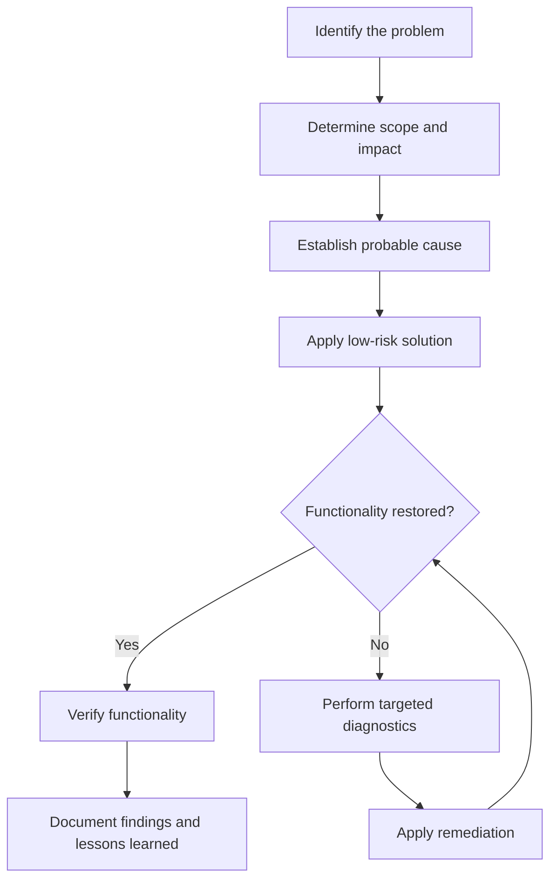
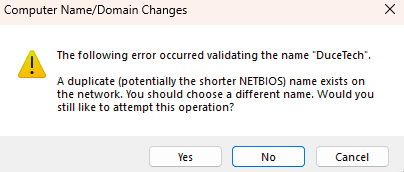
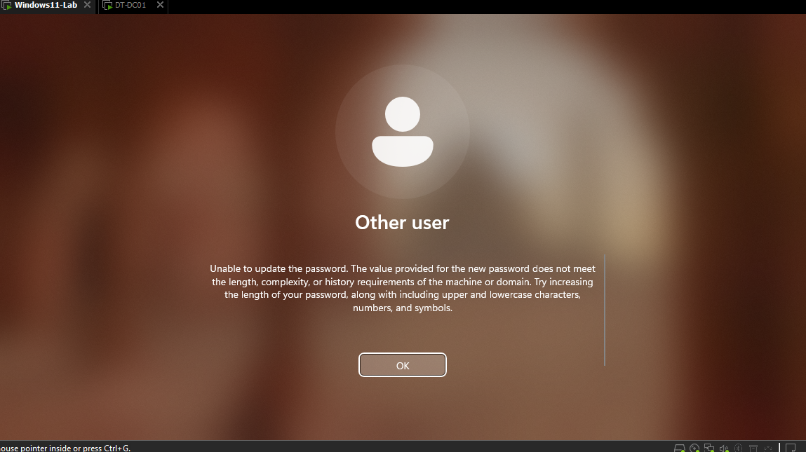
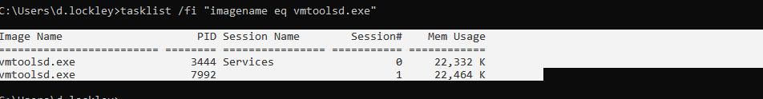
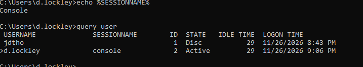

# Phase 02 — Troubleshooting Documentation

## Overview

This document records technical incidents encountered during Windows 11 workstation deployment, Active Directory domain integration, and centralized authentication.

Each incident follows a structured troubleshooting methodology covering symptoms, investigation, resolution, verification, and lessons learned.

---

## Incident 01 — Workstation Naming Warning

**Category:** Active Directory / Endpoint Administration

**Status:** Resolved

### Symptoms

A warning appeared during the initial domain join attempt while the workstation was named DuceTech.

### Investigation

- Reviewed the existing workstation hostname.
- Compared the workstation name against the domain naming configuration.
- Identified a potential naming conflict with the DUCETECH NetBIOS domain name.

### Resolution

1. Opened System Properties using sysdm.cpl.
2. Renamed the workstation to DT-WS01.
3. Restarted the workstation.
4. Initiated the domain join process again.
5. Authenticated using authorized domain administrator credentials.

### Verification

- Successfully joined ducetech.test.
- Confirmed domain membership using PowerShell.
- Verified the DT-WS01 computer object in Active Directory Users and Computers.

### Lessons Learned

- Standardized naming conventions improve endpoint identification and administration.
- Workstation names should be reviewed before domain integration.
- The exact cause of the original warning was not independently confirmed.

---

## Incident 02 — Domain Password Policy Rejection

**Category:** Identity and Access Management

**Status:** Resolved

### Symptoms

The newly provisioned domain user, Dale Lockley, received a password rejection during the mandatory first-logon password change.

### Investigation

- Identified that the rejection occurred during password modification.
- Recognized that domain password requirements must be satisfied.
- Reviewed the attempted password without recording sensitive credentials.

### Resolution

Entered an acceptable password that satisfied the applicable domain password requirements.

### Verification

- Password change completed successfully.
- Domain user authentication succeeded.
- Verified the authenticated identity using whoami.
- Confirmed DT-DC01 as the logon server.

### Lessons Learned

- Active Directory centrally enforces domain password policies.
- Password rejection does not necessarily indicate an authentication infrastructure failure.
- Credentials must never be exposed in technical documentation.

---

## Incident 03 — VMware Host-to-Guest Clipboard Failure

**Category:** Virtualization / Desktop Support

**Status:** Resolved

### Symptoms

Text could not be copied from the physical host computer into the Windows 11 virtual workstation after signing into a newly created domain user account.

### Investigation

| Diagnostic Test | Finding |
|---|---|
| Internal guest clipboard | Functional |
| Host Notepad to guest Notepad | Failed |
| VMware Tools installation | Present |
| VMware Tools service | Running |
| Service startup configuration | Automatic |
| Guest Isolation settings | Copy and paste enabled |
| VMware Tools process inspection | Processes detected in sessions 0 and 1 |
| Domain user session | Session 2 |
| Manual VMware Tools user-process launch | Did not restore functionality |

The investigation isolated the issue to host-to-guest clipboard integration rather than the internal Windows clipboard.

A VMware Tools user-session initialization issue was suspected but not conclusively established.

### Diagnostic Commands

```cmd
tasklist /fi "imagename eq vmtoolsd.exe"
```

```cmd
query user
```

```cmd
echo %SESSIONNAME%
```

### Resolution

1. Restarted the Windows 11 virtual workstation.
2. Signed into the domain user account.
3. Retested host-to-guest clipboard functionality.

### Verification

Successfully copied text from the physical host into the virtual workstation.

No VMware Tools reinstallation was required.

### Lessons Learned

- Isolate application-specific issues from operating system and virtualization issues.
- A running system service does not guarantee that every user-session component is functioning correctly.
- Prioritize simple, low-risk remediation before extensive diagnostics.
- Successful remediation does not automatically establish the underlying root cause.
- Troubleshooting efficiency is essential in enterprise support environments.

---

## Incident 04 — Windows Security Update Stalled

**Category:** Windows Update / Endpoint Maintenance

**Status:** Pending Verification

### Symptoms

A Windows security update appeared stalled at 12 percent.

### Environmental Considerations

- The workstation operates on an isolated VMware LAN segment.
- No default gateway is configured.
- External internet connectivity is unavailable through the current network configuration.

Limited external connectivity may have contributed to the update issue. However, this has not been confirmed.

### Action Taken

Deferred further update troubleshooting to avoid delaying the primary domain integration objectives.

### Follow-Up Actions

- Verify Windows Update history.
- Determine whether the update completed successfully.
- Review update error codes if present.
- Establish controlled internet connectivity if required.
- Preserve internal Active Directory DNS configuration.

---

## Troubleshooting Methodology



## Incident Summary

| Incident | Technical Area | Status |
|---|---|---|
| INC-02-001 | Workstation Naming | Resolved |
| INC-02-002 | Password Policy Enforcement | Resolved |
| INC-02-003 | VMware Clipboard Integration | Resolved |
| INC-02-004 | Windows Update | Pending Verification |

## Professional Skills Demonstrated

- Structured technical troubleshooting
- Incident documentation
- Root cause investigation
- Windows endpoint administration
- Active Directory troubleshooting
- Identity and access management
- VMware Tools diagnostics
- Windows service and process analysis
- User-session troubleshooting
- Resolution verification
- Incident prioritization
- Infrastructure change management


## Supporting Evidence

### Incident 01 — Workstation Naming Conflict



### Incident 02 — Password Policy Enforcement



### Incident 03 — VMware Clipboard Troubleshooting

#### VMware Tools Process Inspection



#### Windows User Session Inspection


