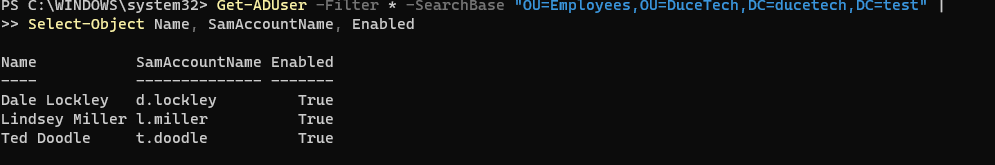
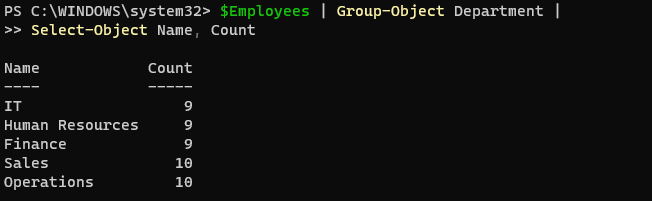
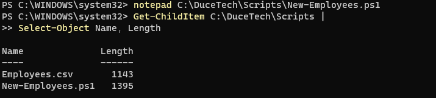
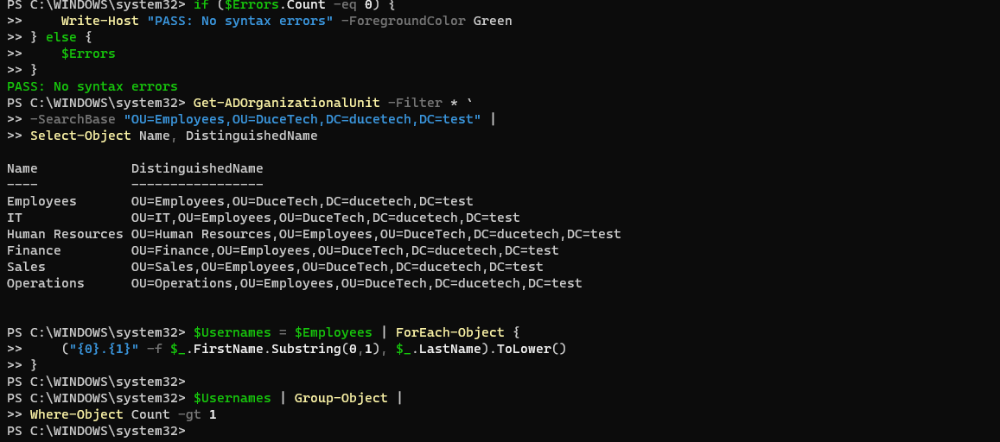
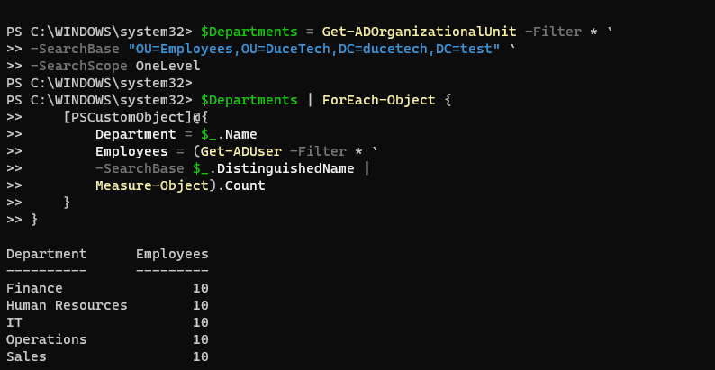
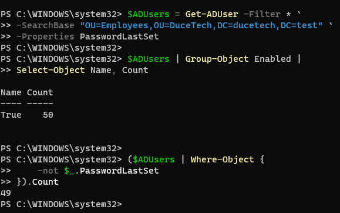
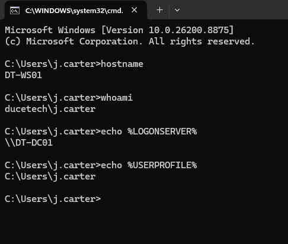
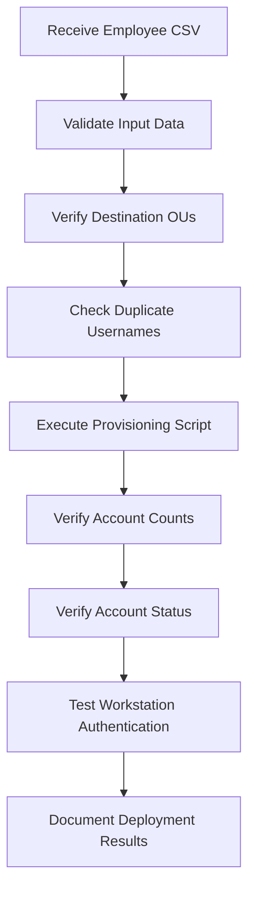

# Phase 03 — PowerShell Commands and Administrative Reference

## Overview

This reference documents the PowerShell commands used to implement, automate, validate, and troubleshoot Active Directory employee provisioning within the DuceTech enterprise environment.

## 1. Prepare the Automation Workspace

Execution environment: DT-DC01 Windows Server VM, Windows PowerShell as Administrator.

```powershell
New-Item -Path "C:\DuceTech\Scripts" -ItemType Directory -Force

Import-Module ActiveDirectory
```

### Command Breakdown

| Command | Purpose |
|---|---|
| New-Item | Creates a file or directory |
| -ItemType Directory | Specifies that a directory should be created |
| -Force | Allows the operation to proceed if the directory already exists |
| Import-Module | Loads additional PowerShell functionality |
| ActiveDirectory | Provides Active Directory administration cmdlets |

## 2. Verify Existing Employee Accounts

```powershell
Get-ADUser -Filter * `
-SearchBase "OU=Employees,OU=DuceTech,DC=ducetech,DC=test" |
Select-Object Name, SamAccountName, Enabled
```

### Purpose

Establishes the existing employee account baseline before bulk provisioning.

### Results

- Three existing employee accounts.
- All three accounts enabled.
- Standardized username convention confirmed.



## 3. Create and Import the Employee CSV

```powershell
notepad C:\DuceTech\Scripts\Employees.csv

$Employees = Import-Csv "C:\DuceTech\Scripts\Employees.csv"

$Employees.Count

$Employees | Group-Object Department |
Select-Object Name, Count
```

### Command Breakdown

| Command or Syntax | Purpose |
|---|---|
| Import-Csv | Converts CSV records into PowerShell objects |
| $Employees | Stores imported employee records |
| .Count | Returns the number of records |
| Group-Object | Groups records by a specified property |
| Select-Object | Displays selected properties |
| Pipe operator | Passes output from one command to another |

### Validation Results

| Department | Incoming Employees |
|---|---:|
| IT | 9 |
| Human Resources | 9 |
| Finance | 9 |
| Sales | 10 |
| Operations | 10 |
| Total | 47 |



## 4. Create the Provisioning Script

```powershell
notepad C:\DuceTech\Scripts\New-Employees.ps1
```

The provisioning script reads employee records, generates standardized usernames, identifies destination OUs, checks existing accounts, and creates new Active Directory users.

### Core Automation Components

| Component | Function |
|---|---|
| foreach | Iterates through employee records |
| Substring(0,1) | Extracts the first initial |
| ToLower() | Standardizes username capitalization |
| if | Evaluates a condition |
| continue | Skips to the next employee record |
| try | Attempts an operation |
| catch | Handles terminating errors |
| New-ADUser | Creates an Active Directory user |
| Read-Host -AsSecureString | Accepts password input without displaying plaintext |
| Write-Host | Displays provisioning status |

### New-ADUser Parameters

| Parameter | Purpose |
|---|---|
| -Name | Defines the directory object's name |
| -GivenName | Assigns the employee's first name |
| -Surname | Assigns the employee's last name |
| -DisplayName | Defines the displayed employee name |
| -SamAccountName | Assigns the traditional Windows logon name |
| -UserPrincipalName | Assigns the domain-qualified logon name |
| -Department | Populates the department attribute |
| -Path | Specifies the destination OU |
| -AccountPassword | Assigns the initial password |
| -Enabled | Enables the account |
| -ChangePasswordAtLogon | Requires an initial password change |
| -ErrorAction Stop | Converts applicable errors into terminating errors for handling |

### Security Considerations

No credentials were hardcoded into the script or stored in the CSV.

A shared temporary password was used for fictional accounts within the isolated lab. Production environments should use unique temporary passwords and secure credential distribution.

See the [Provisioning Script](Scripts/New-Employees.ps1) for the complete implementation.

## 5. Verify Automation Files

```powershell
Get-ChildItem C:\DuceTech\Scripts |
Select-Object Name, Length
```

### Purpose

Confirms that the CSV roster and PowerShell script exist and contain data.



## 6. Validate PowerShell Syntax

```powershell
$Tokens = $null
$Errors = $null

[System.Management.Automation.Language.Parser]::ParseFile(
    "C:\DuceTech\Scripts\New-Employees.ps1",
    [ref]$Tokens,
    [ref]$Errors
) | Out-Null

if ($Errors.Count -eq 0) {
    Write-Host "PASS: No syntax errors" -ForegroundColor Green
} else {
    $Errors
}
```

### Purpose

Checks the script for syntax errors without executing the provisioning operation.

Result: No syntax errors detected.

Syntax validation does not guarantee successful runtime execution.

## 7. Verify Destination Organizational Units

```powershell
Get-ADOrganizationalUnit -Filter * `
-SearchBase "OU=Employees,OU=DuceTech,DC=ducetech,DC=test" |
Select-Object Name, DistinguishedName
```

### Purpose

Confirms that the departmental organizational units exist before employee provisioning.

A distinguished name identifies an object's location within the Active Directory hierarchy.

Example:

OU=IT,OU=Employees,OU=DuceTech,DC=ducetech,DC=test

## 8. Check for Duplicate Usernames

```powershell
$Usernames = $Employees | ForEach-Object {
    ("{0}.{1}" -f $_.FirstName.Substring(0,1), $_.LastName).ToLower()
}

$Usernames | Group-Object |
Where-Object Count -gt 1
```

### Purpose

Identifies duplicate generated usernames within the incoming CSV roster.

Result: No duplicate usernames detected.

The provisioning script separately checks for existing AD user accounts.



## 9. Execute Bulk Employee Provisioning

```powershell
& "C:\DuceTech\Scripts\New-Employees.ps1"
```

The call operator (&) executes the PowerShell script at the specified path.

The script prompts for a temporary password and processes the employee roster.

### Provisioning Status Messages

| Status | Meaning |
|---|---|
| CREATED | Account creation completed |
| SKIPPED | An existing username was detected |
| FAILED | An error occurred during provisioning |

### Results

- 47 additional employee accounts provisioned.
- 50 total employee accounts following deployment.
- All five departments populated with 10 employees each.

## 10. Verify Total Employee Count

```powershell
$ADUsers = Get-ADUser -Filter * `
-SearchBase "OU=Employees,OU=DuceTech,DC=ducetech,DC=test"

$ADUsers.Count

$ADUsers | Group-Object Enabled |
Select-Object Name, Count
```

### Results

| Metric | Count |
|---|---:|
| Total Employees | 50 |
| Enabled Accounts | 50 |
| Disabled Accounts | 0 |

## 11. Verify Departmental Placement

```powershell
$Departments = Get-ADOrganizationalUnit -Filter * `
-SearchBase "OU=Employees,OU=DuceTech,DC=ducetech,DC=test" `
-SearchScope OneLevel

$Departments | ForEach-Object {
    [PSCustomObject]@{
        Department = $_.Name
        Employees = (Get-ADUser -Filter * `
        -SearchBase $_.DistinguishedName |
        Measure-Object).Count
    }
}
```

### Command Breakdown

| Syntax | Purpose |
|---|---|
| -SearchScope OneLevel | Searches immediate child objects |
| ForEach-Object | Processes each object in the pipeline |
| $_ | Represents the current pipeline object |
| PSCustomObject | Creates structured output |
| DistinguishedName | Identifies the current OU location |
| Measure-Object | Counts returned objects |

### Results

| Department | Employees |
|---|---:|
| Finance | 10 |
| Human Resources | 10 |
| IT | 10 |
| Operations | 10 |
| Sales | 10 |
| Total | 50 |



## 12. Verify Employee Account Health

```powershell
$ADUsers = Get-ADUser -Filter * `
-SearchBase "OU=Employees,OU=DuceTech,DC=ducetech,DC=test" `
-Properties PasswordLastSet

$ADUsers | Group-Object Enabled |
Select-Object Name, Count

($ADUsers | Where-Object {
    -not $_.PasswordLastSet
}).Count
```

### Results Before Final Authentication Testing

- 50 enabled employee accounts.
- Zero disabled employee accounts.
- 49 accounts awaiting their initial password change.

The original Phase 02 employee had already completed the initial password change.



## 13. Verify Workstation Authentication

Execution environment: Windows11-Lab (hostname DT-WS01), Command Prompt, standard domain user.

```cmd
hostname
whoami
echo %LOGONSERVER%
echo %USERPROFILE%
```

### Command Breakdown

| Command | Purpose |
|---|---|
| hostname | Displays the workstation hostname |
| whoami | Displays the current authenticated identity |
| echo %LOGONSERVER% | Displays the session's logon server |
| echo %USERPROFILE% | Displays the current user profile location |

### Actual Results

| Verification | Result |
|---|---|
| Hostname | DT-WS01 |
| Identity | ducetech\j.carter |
| Logon Server | \\DT-DC01 |
| User Profile | C:\Users\j.carter |

Successfully validated workstation authentication and local profile initialization for a PowerShell-provisioned employee.



## 14. Infrastructure Recovery Commands

### Physical Host — PowerShell as Administrator

```powershell
Get-ChildItem "C:\Program Files\VMware" `
-Filter vmware-vdiskmanager.exe -Recurse
```

Located the VMware virtual disk repair utility.

```powershell
& "C:\Program Files\VMware\VMware Workstation\vmware-vdiskmanager.exe" -R "C:\DuceTech-Lab\DT-DC01\DT-DC01-000002.vmdk"
```

Successfully repaired the identified corrupted virtual disk.

This command is documented as an incident-specific recovery action, not a routine maintenance procedure.

### DT-DC01 VM — PowerShell as Administrator

```powershell
Get-ADDomain | Select-Object DNSRoot, NetBIOSName

Get-Service NTDS, DNS

dcdiag /test:DNS /DnsBasic
```

Confirmed Active Directory and DNS functionality following recovery.


## 15. Enterprise Automation Workflow



## Skills Demonstrated

- PowerShell scripting
- Active Directory cmdlets
- CSV processing
- Variables and object manipulation
- Conditional logic
- Loop-based automation
- Error handling
- Secure password input
- Predeployment validation
- Postdeployment verification
- Domain authentication diagnostics
- Infrastructure recovery

## Known Limitations

The automation was developed for a controlled lab environment.

Production implementations should include unique credential generation, persistent audit logging, more comprehensive input validation, least-privilege execution, and procedures for handling partially created accounts.

Post-restart infrastructure integrity verification remains pending following the unexpected physical host restart.
