# Phase 03 — Organizational Units & Automated User Provisioning

## Project Overview

Designed and implemented a departmental Active Directory organizational structure supporting a 50-employee enterprise environment.

This phase combines manual identity administration, PowerShell automation, CSV-based employee provisioning, predeployment validation, and workstation authentication testing.

## Objectives

- Establish a structured organizational unit hierarchy.
- Organize employees and domain-joined workstations.
- Implement standardized account naming conventions.
- Provision employee accounts manually and through PowerShell automation.
- Validate account status and departmental placement.
- Verify successful domain authentication and first-logon profile initialization.

## Environment

| Component | Configuration |
|---|---|
| Hypervisor | VMware Workstation |
| Domain Controller | DT-DC01 |
| Server OS | Windows Server 2025 Standard Evaluation |
| Domain | ducetech.test |
| NetBIOS Domain | DUCETECH |
| Workstation VM | Windows11-Lab |
| Workstation Hostname | DT-WS01 |
| Client OS | Windows 11 |
| Domain Controller IP | 192.168.50.10 |
| Workstation IP | 192.168.50.20 |
| Network | DuceTech-LAN |
| Administration Tools | ADUC, Windows PowerShell |

## Organizational Unit Architecture

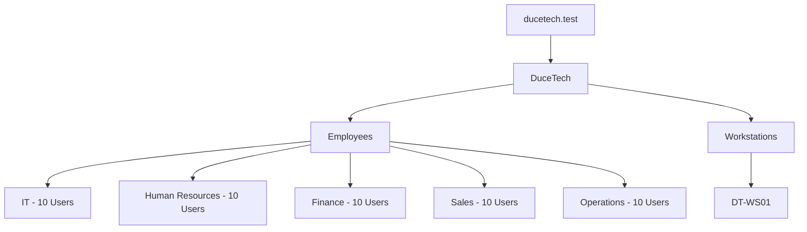

## Implementation

### 1. Organizational Unit Deployment

Created eight custom organizational units to establish a scalable administrative structure.

- DuceTech
- Employees
- Workstations
- IT
- Human Resources
- Finance
- Sales
- Operations

Enabled accidental deletion protection during OU creation.

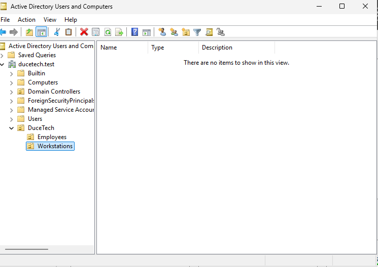

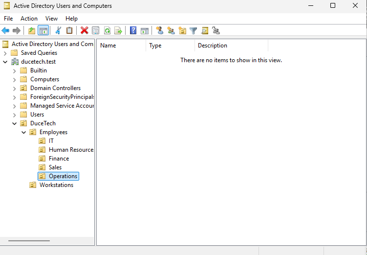

### 2. Existing Object Relocation

Moved the existing DT-WS01 computer object from the default Computers container into the Workstations OU.

Moved the existing domain employee account into the IT departmental OU.

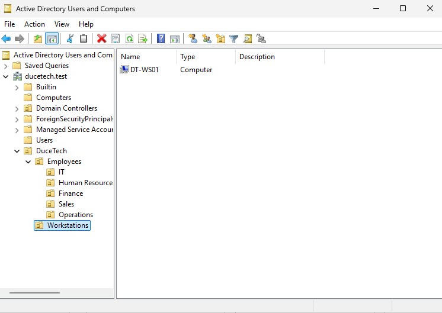

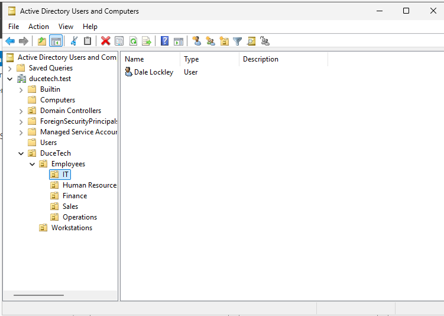

### 3. Manual Employee Provisioning

Created two additional employee accounts through Active Directory Users and Computers.

Established a standardized username convention using the first initial and last name.

Example: j.carter@ducetech.test

Configured newly created accounts to require a password change at first logon.

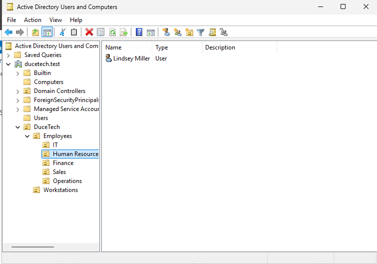

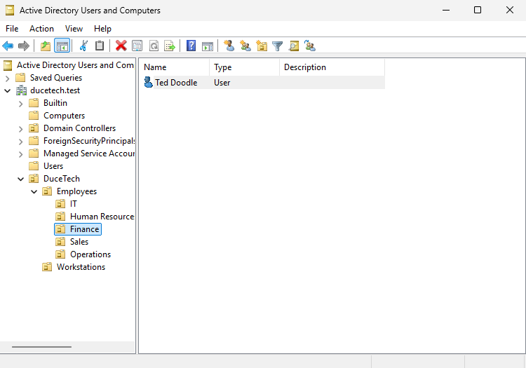

### 4. CSV-Based Employee Provisioning

Established a dedicated automation workspace:

C:\DuceTech\Scripts

Created an employee CSV roster containing 47 additional employee records.

Validated the existing three-account baseline and confirmed the departmental distribution of the incoming employee roster.

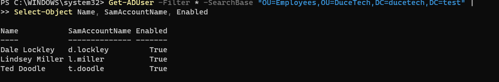

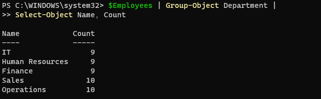

### 5. PowerShell Automation

Developed a reusable PowerShell provisioning script using the Active Directory module.

Automation capabilities included:

- CSV data import.
- Standardized username generation.
- Departmental OU assignment.
- Existing account detection.
- Secure-string password input.
- Mandatory initial password changes.
- Conditional logic and error handling.

A shared temporary password was used exclusively within the isolated training environment. Production deployments should use unique temporary credentials and secure distribution procedures.

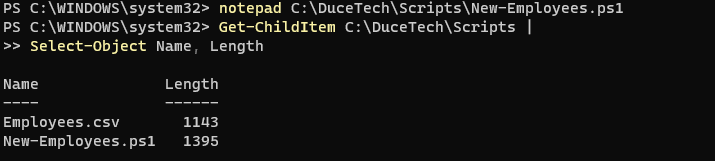

### 6. Predeployment Validation

Performed validation before executing the provisioning script.

- Verified PowerShell syntax.
- Confirmed all destination OUs existed.
- Checked the CSV roster for duplicate usernames.
- Confirmed the expected employee count.

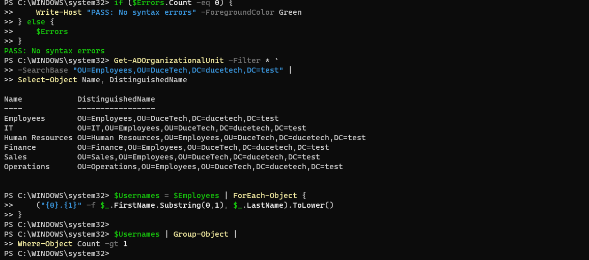

### 7. Bulk Employee Provisioning

Executed the PowerShell automation to provision 47 additional employee accounts.

Combined with the three existing manually provisioned accounts, the completed environment supported 50 employee identities across five departments.

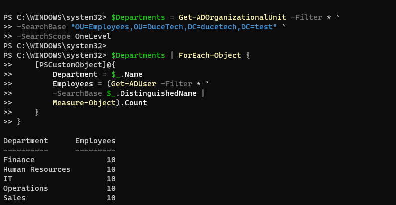

### 8. Account Health Verification

Verified all 50 employee accounts were enabled.

Before the final authentication test, 49 accounts were awaiting their initial password change. The existing Phase 02 employee had already completed this requirement.

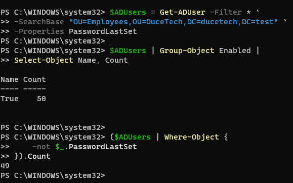

## Employee Authentication and First-Logon Validation

Tested a PowerShell-provisioned employee account on Windows11-Lab (DT-WS01).

### Initial Password Change

Successfully completed the initial password change for the automated employee account.

### First-Logon Profile Initialization

Following the successful password change, Windows 11 began preparing the newly provisioned employee's local user profile.

This demonstrates the transition from centralized Active Directory identity provisioning to workstation-level user environment initialization.

### Authentication Verification

| Verification | Result |
|---|---|
| Workstation | DT-WS01 |
| Domain Identity | ducetech\j.carter |
| Logon Server | \\DT-DC01 |
| User Profile | C:\Users\j.carter |
| Authentication | Successful |

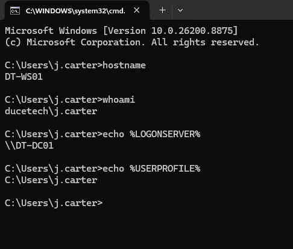

## Deployment Results

| Metric | Result |
|---|---:|
| Custom Organizational Units | 8 |
| Departments | 5 |
| Manually Provisioned Accounts | 3 |
| Automated Account Creations | 47 |
| Total Employee Accounts | 50 |
| Enabled Accounts | 50 |
| Disabled Accounts | 0 |
| Employees Per Department | 10 |
| Automated Account Authentication Tests Passed | 1 |

## Troubleshooting and Recovery

Recovered the domain controller from a VMware virtual disk corruption incident before proceeding with implementation.

Validated Active Directory and DNS functionality following the recovery.

An unexpected physical host restart occurred after the final successful authentication test. Its cause remains undetermined, and post-restart VM integrity verification is pending.

See [Troubleshooting Documentation](Troubleshooting.md) for additional details.

## Skills Demonstrated

- Active Directory Administration
- Organizational Unit Management
- Identity Lifecycle Management
- Employee Onboarding
- PowerShell Scripting
- CSV Data Processing
- Bulk User Provisioning
- Password Policy Enforcement
- Deployment Validation
- Windows Domain Authentication
- Windows User Profile Initialization
- Virtual Infrastructure Recovery
- Technical Documentation

## Supporting Documentation

- [Troubleshooting](Troubleshooting.md)
- [PowerShell Commands](PowerShell-Commands.md)
- [Employee CSV Roster](Scripts/Employees.csv)
- [PowerShell Provisioning Script](Scripts/New-Employees.ps1)

## Project Status

Technical implementation and pre-crash validation completed.

## Next Phase

Phase 04 — Security Groups and Resource Permissions
