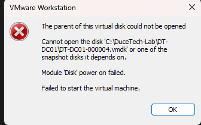
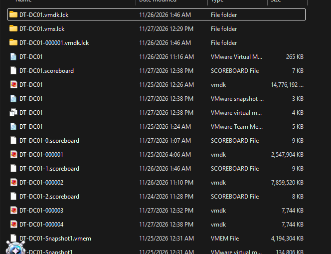
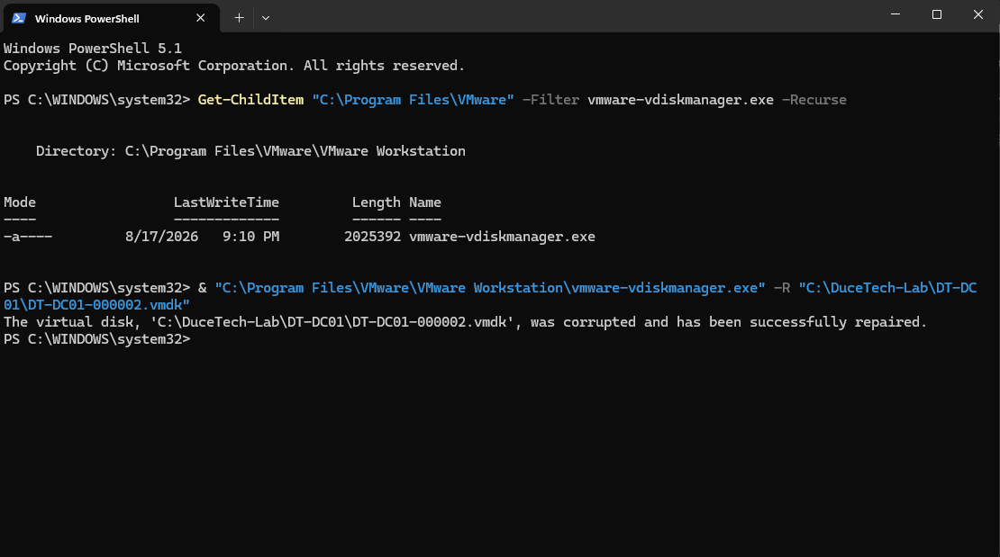
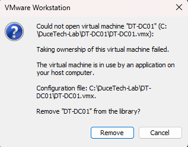
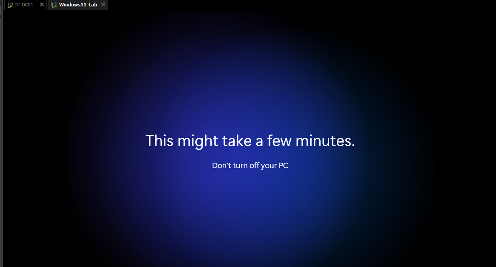
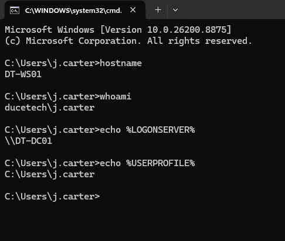
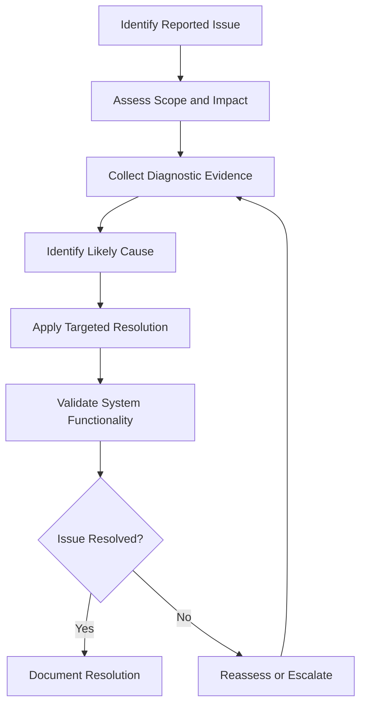

# Phase 03 — Troubleshooting and Incident Recovery

## Incident Summary

| Incident | Category | Status |
|---|---|---|
| INC-001 | Virtual disk dependency failure | Resolved |
| INC-002 | VMware virtual machine ownership error | Resolved |
| INC-003 | Unexpected physical host restart | Investigation deferred |

---

## INC-001 — Virtual Disk Dependency Failure

### Environment

- Hypervisor: VMware Workstation
- Virtual Machine: DT-DC01
- Operating System: Windows Server 2025
- Domain: ducetech.test
- Date: November 27, 2026

### Reported Issue

The domain controller failed to power on following the creation of a predeployment snapshot.

### Error Message

> The parent of this virtual disk could not be opened.
>
> Cannot open the disk or one of the snapshot disks it depends on.
>
> Module 'Disk' power on failed.



### Business Impact

- Domain controller unavailable.
- Active Directory administration interrupted.
- DNS services unavailable.
- Employee provisioning deployment delayed.
- Potential risk to previously implemented infrastructure.

### Diagnostic Actions

1. Inspected the virtual machine directory.
2. Identified existing virtual disks and snapshot files.
3. Inspected VMware lock directories.
4. Reviewed running VMware processes.
5. Reviewed VMware diagnostic logs.
6. Identified a virtual disk requiring repair.



### Root Cause Findings

VMware's disk repair utility confirmed corruption in the following virtual disk:

DT-DC01-000002.vmdk

The underlying cause of the corruption was not established.

Although the failure appeared following snapshot creation, the timing alone does not establish that snapshot creation caused the corruption.

### Resolution

Located the VMware Virtual Disk Manager utility on the physical Windows host.

Executed the following command from host PowerShell:

```powershell
& "C:\Program Files\VMware\VMware Workstation\vmware-vdiskmanager.exe" -R "C:\DuceTech-Lab\DT-DC01\DT-DC01-000002.vmdk"
```

VMware reported that the corrupted virtual disk had been successfully repaired.



Successfully powered on DT-DC01 following the repair.

### Post-Recovery Validation

Executed the following commands inside the DT-DC01 Windows Server virtual machine:

```powershell
Get-ADDomain | Select-Object DNSRoot, NetBIOSName

Get-Service NTDS, DNS

dcdiag /test:DNS /DnsBasic
```

### Verification Results

| Component | Result |
|---|---|
| Virtual machine startup | Successful |
| Active Directory domain | ducetech.test |
| NetBIOS domain | DUCETECH |
| Active Directory Domain Services | Running |
| DNS Server service | Running |
| DCDiag Connectivity test | Passed |
| DCDiag DNS test | Passed |


### Final Status

Resolved.

Core domain controller services were operational, allowing Phase 03 implementation to resume.

---

## INC-002 — VMware Virtual Machine Ownership Error

### Reported Issue

VMware Workstation reported that ownership of DT-DC01 could not be obtained during recovery of the virtual disk dependency failure.

### Error Message

> Taking ownership of this virtual machine failed.
>
> The virtual machine is in use by an application on your host computer.



### Diagnostic Actions

- Inspected VMware-related processes.
- Identified existing virtual machine lock directories.
- Relocated the identified lock directories to a separate backup location.
- Restarted the physical host.
- Continued reviewing virtual disk diagnostics when the error persisted.

### Resolution

The virtual machine became accessible following successful repair of the corrupted virtual disk.

The exact mechanism responsible for the ownership error was not independently established.

### Lessons Learned

- A virtual machine ownership error does not necessarily establish that another active process is using the VM.
- Lock directories should not be removed indiscriminately.
- Review virtual disk dependencies and diagnostic logs before modifying snapshot files.
- Avoid deleting or manually editing virtual disks during recovery.

### Final Status

Resolved as part of the broader virtual machine recovery.

---

## INC-003 — Unexpected Physical Host Restart

### Reported Issue

The physical Windows host unexpectedly restarted immediately after successful authentication testing of a PowerShell-provisioned employee.

### Observed Behavior

- Sudden physical host restart.
- No visible blue screen reported.
- Both virtual machines had been running.
- Final employee authentication evidence was captured before the restart.

### Initial Diagnostic Actions

Reviewed Windows Reliability Monitor on the physical host.

The available reliability information had last been updated at 4:00 PM, before the most recent unexpected restart.

Earlier critical events were visible, but none established the cause of the latest incident.

### Root Cause

Undetermined.

No direct connection between the unexpected restart and VMware, resource utilization, hardware failure, or the earlier virtual disk corruption was established.

### Current Status

Investigation deferred.

Post-restart virtual machine integrity verification remains pending.

Further investigation will be performed if the unexpected restart recurs.

---

## Normal System Behavior — First-Logon Profile Initialization

During authentication testing, Windows displayed a first-logon preparation screen after the newly provisioned employee successfully changed their temporary password.



This was expected behavior and not a system failure.

Successful profile initialization was subsequently verified through Command Prompt on Windows11-Lab (DT-WS01).



---

## Troubleshooting Methodology



## Skills Demonstrated

- Virtual infrastructure troubleshooting
- VMware diagnostic log analysis
- Virtual disk dependency investigation
- Virtual disk repair
- Windows process inspection
- Windows Reliability Monitor
- Active Directory service verification
- DNS service validation
- Incident documentation
- Root cause assessment
- Post-recovery validation
- Risk-aware troubleshooting
