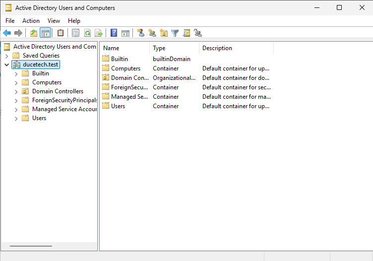
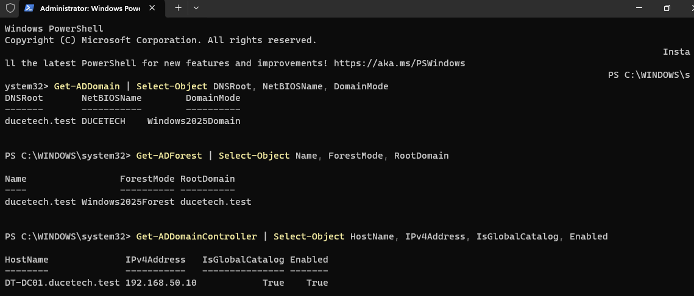
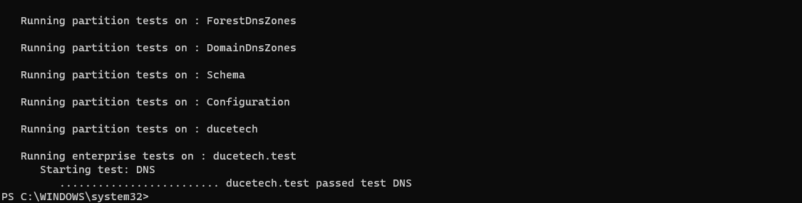

# 🛡️ DuceTech | Enterprise IT Support & Security Operations

### Hands-On IT Support • Service Desk Operations • Cybersecurity

Welcome to **DuceTech-IT-Lab**, my independent technical training and professional development portfolio.

This repository documents practical exercises in Windows desktop support, enterprise service desk operations, system administration, networking, identity and access management, and cybersecurity.

My objective is to bridge the gap between technical certifications and real-world IT responsibilities by developing hands-on troubleshooting skills, documenting technical procedures, and strengthening my understanding of enterprise environments.

The portfolio is organized into four primary areas:

1. **Enterprise IT Support** — Hands-on Windows troubleshooting and system administration.
2. **Service Desk Simulations** — Structured end-user support scenarios and enterprise IT workflows.
3. **Enterprise Infrastructure Lab** — Windows Server administration, Active Directory, DNS, and enterprise network deployment.
4. **Security Operations** — Windows security investigations, network analysis, and SOC development.

All work is performed in independent lab or training environments and is not represented as production employment experience.

---

## 📂 Explore the Portfolio

| Portfolio Section | Description | Documentation |
|---|---|---|
| 🖥️ Enterprise IT Support | Six hands-on Windows troubleshooting case studies | [View IT Support](IT-Support/README.md) |
| 🎧 Service Desk Simulations | Ten documented enterprise service desk training scenarios | [View Simulations](IT-Support/ServiceDesk-Simulations/README.md) |
| 🏢 Enterprise Infrastructure Lab | Windows Server 2025, Active Directory, DNS, and infrastructure troubleshooting | [View Infrastructure Lab](Enterprise-Infrastructure-Lab/Phase-01-Server-AD-DNS/README.md) |
| 🔐 Security Operations | Windows event analysis, network investigation, and SOC lab development | [View SOC Roadmap](#-04--security-operations--soc-home-lab) |
---

# 🖥️ 01 — Enterprise IT Support

### Windows Administration | Troubleshooting | Desktop Support

This section demonstrates hands-on technical troubleshooting using a Windows lab environment.

The exercises focus on identifying technical issues, investigating possible causes, applying corrective actions, and documenting results.

## Completed IT Support Case Studies

| Case Study | Technical Focus |
|---|---|
| Support 01 — Printer Troubleshooting | Printer configuration, test-page verification, and print troubleshooting |
| Support 02 — File Migration | File staging, copying, and migration verification |
| Support 03 — PDF Viewer Troubleshooting | Application behavior, file associations, and browser-based PDF viewing |
| Support 04 — Network Connectivity | TCP/IP troubleshooting, gateway connectivity, DNS resolution, and command-line diagnostics |
| Support 05 — Application Execution Restrictions | Windows administrative policies and application execution troubleshooting |
| Support 06 — NTFS Permissions | File permissions, ownership, access control, and Windows security |

### Technical Skills Developed

- Windows 10/11 desktop troubleshooting
- Command Prompt and PowerShell
- Network connectivity diagnostics
- DNS and TCP/IP fundamentals
- NTFS permissions and access control
- Application troubleshooting
- File management and migration
- Technical documentation

### [View Enterprise IT Support Documentation](IT-Support/README.md)

---

# 🎧 02 — Service Desk Simulations

### End-User Support | Incident Management | Enterprise IT Operations

This section contains **10 documented service desk training scenarios** involving common Tier 1 support requests and enterprise technical workflows.

The simulations provide practice in investigating reported problems, communicating with users, following technical procedures, and documenting troubleshooting decisions.

## Documented Service Desk Tickets

| Ticket | Scenario | Technical Focus |
|---|---|---|
| [01](IT-Support/ServiceDesk-Simulations/Ticket-01-Replacement-Workstation.md) | Replacement Workstation Deployment | PXE imaging, workstation configuration, and asset management |
| [02](IT-Support/ServiceDesk-Simulations/Ticket-02-Office-Wide-Printer-Outage.md) | Office-Wide Printer Outage | Print server troubleshooting and incident management |
| [03](IT-Support/ServiceDesk-Simulations/Ticket-03-Windows-Time-Synchronization.md) | Windows Time Synchronization | System configuration and time synchronization |
| [04](IT-Support/ServiceDesk-Simulations/Ticket-04-Second-Monitor-Graphics-Driver.md) | Second Monitor Not Detected | Graphics drivers, Windows updates, and remote support |
| [05](IT-Support/ServiceDesk-Simulations/Ticket-05-Password-Expiration-Account-Access.md) | Password Expiration | Authentication and account access |
| [06](IT-Support/ServiceDesk-Simulations/Ticket-06-Legal-Name-Change-Email-Alias.md) | Legal Name Change & Email Alias | Account administration and email identity |
| [07](IT-Support/ServiceDesk-Simulations/Ticket-07-Department-Transfer-Access-Management.md) | Department Transfer | Security group management and least-privilege access |
| [08](IT-Support/ServiceDesk-Simulations/Ticket-08-New-Employee-Provisioning.md) | New Employee Provisioning | Account creation and access assignment |
| [09](IT-Support/ServiceDesk-Simulations/Ticket-09-Remote-Shared-Drive-Connectivity.md) | Remote Shared-Drive Connectivity | VPN, DNS, and mapped network drives |
| [10](IT-Support/ServiceDesk-Simulations/Ticket-10-WiFi-Connectivity.md) | Wi-Fi Connectivity | Wireless network troubleshooting |

## Core Competencies

**Desktop & Endpoint Support**
- Windows workstation troubleshooting
- Device drivers and updates
- Workstation imaging and deployment
- Hardware and software support

**Identity & Access Management**
- User account provisioning
- Password-related access issues
- Security group membership
- Departmental access changes
- Email identity administration

**Networking & Connectivity**
- DNS troubleshooting
- VPN connectivity
- Wireless networking
- Mapped network drives
- Remote troubleshooting

**Service Desk Operations**
- Incident investigation
- Service request fulfillment
- User communication
- Technical documentation
- Escalation decisions
- Asset management

Individual case studies distinguish completed simulator actions from recommended procedures and unresolved outcomes.

### [Explore All 10 Service Desk Simulations](IT-Support/ServiceDesk-Simulations/README.md)

---

# 🏢 03 — Enterprise Infrastructure Lab

### Windows Server | Active Directory | DNS | Enterprise Systems Administration

The DuceTech Enterprise Infrastructure Lab is an independent, hands-on project designed to develop practical experience in deploying, administering, and troubleshooting enterprise IT infrastructure.

The environment is being developed to support 50 employee accounts, centralized authentication, departmental access management, workstation administration, and enterprise IT support operations.

## Completed Infrastructure Deployment

- Deployed Windows Server 2025 using VMware Workstation.
- Configured an isolated virtual enterprise network.
- Configured static IPv4 addressing.
- Installed Active Directory Domain Services and DNS Server roles.
- Established the ducetech.test Active Directory forest and domain.
- Promoted DT-DC01 to a domain controller.
- Configured forward and reverse DNS lookup functionality.
- Created and verified DNS A and PTR records.
- Validated LDAP SRV records for domain controller discovery.
- Executed PowerShell and DCDiag infrastructure diagnostics.
- Established virtual machine recovery checkpoints.
- Documented five technical troubleshooting incidents.

## Infrastructure Environment

| Component | Configuration |
|---|---|
| Server | DT-DC01 |
| Operating System | Windows Server 2025 Standard Evaluation |
| Virtualization | VMware Workstation |
| Active Directory Domain | ducetech.test |
| NetBIOS Domain | DUCETECH |
| Server IPv4 Address | 192.168.50.10 |
| Network | 192.168.50.0/24 |
| Network Type | Isolated Virtual LAN |
| Directory Services | Active Directory Domain Services |
| Name Resolution | Windows DNS Server |

## Infrastructure Development Roadmap

| Phase | Project | Status |
|---|---|---|
| 01 | Windows Server, Active Directory & DNS Deployment | ✅ Complete |
| 02 | Windows 11 Domain Integration | ✅ Complete |
| 03 | Organizational Units & Employee Account Provisioning | ⏳ Next |
| 04 | Security Groups & Access Management | ⏳ Planned |
| 05 | DHCP Deployment & Administration | ⏳ Planned |
| 06 | Group Policy Management | ⏳ Planned |
| 07 | PowerShell Administration & Automation | ⏳ Planned |
| 08 | Enterprise IT Troubleshooting Scenarios | ⏳ Planned |
| 09 | Portfolio Consolidation & Final Documentation | ⏳ Planned |

## Phase 01 — Technical Documentation

| Document | Description |
|---|---|
| [Infrastructure Deployment](Enterprise-Infrastructure-Lab/Phase-01-Server-AD-DNS/README.md) | Architecture, configuration, implementation, and validation evidence |
| [Technical Troubleshooting Report](Enterprise-Infrastructure-Lab/Phase-01-Server-AD-DNS/Troubleshooting.md) | Five documented technical incidents, investigations, and outcomes |
| [PowerShell Command Reference](Enterprise-Infrastructure-Lab/Phase-01-Server-AD-DNS/PowerShell-Commands.md) | Administrative commands and infrastructure diagnostics |
| [Implementation Screenshots](Enterprise-Infrastructure-Lab/Screenshots/) | Ten screenshots documenting deployment and verification |

## Implementation Highlights

### Active Directory Administration



### PowerShell Infrastructure Verification



### Domain Controller Diagnostics




### Phase 02 — Workstation Deployment & Domain Integration

**Status:** Completed

Successfully integrated a Windows 11 Pro workstation into the DuceTech Active Directory environment, establishing centralized authentication and enterprise endpoint management.

**Key accomplishments:**

- Configured static IPv4 addressing and internal DNS.
- Verified network connectivity and domain controller discovery.
- Implemented standardized workstation naming.
- Joined DT-WS01 to the ducetech.test domain.
- Verified Active Directory computer object registration.
- Provisioned and authenticated a standard domain user.
- Verified centralized password policy enforcement.
- Diagnosed and resolved workstation and VMware integration issues.
- Established pre-deployment and post-deployment recovery snapshots.

**Project Documentation:**

- [Phase 02 — Project Overview](Enterprise-Infrastructure-Lab/Phase-02-Workstation-Domain-Join/README.md)
- [Troubleshooting Documentation](Enterprise-Infrastructure-Lab/Phase-02-Workstation-Domain-Join/Troubleshooting.md)
- [PowerShell & Command-Line Reference](Enterprise-Infrastructure-Lab/Phase-02-Workstation-Domain-Join/PowerShell-Commands.md)


## Technical Skills Developed

- Windows Server administration
- Active Directory Domain Services
- Domain controller deployment
- DNS administration and troubleshooting
- IPv4 network configuration
- PowerShell administration
- Infrastructure health diagnostics
- Virtual machine recovery management
- Technical incident documentation

Phase 01 core internal infrastructure functionality has been verified. Historical diagnostic errors remain documented, and additional enterprise services will be implemented in subsequent phases.

---

# 🔐 04 — Security Operations & SOC Home Lab

### Windows Security | Network Investigation | Threat Detection

The DuceTech SOC Home Lab is an independent cybersecurity training environment focused on developing foundational Security Operations Center skills.

This project documents the process of building an enterprise-style Windows environment and developing experience in system administration, security logging, network investigation, and incident analysis.

The long-term objective is to progress toward centralized security monitoring, endpoint telemetry collection, and structured incident response.

## 🎯 SOC Lab Objectives

- Develop practical cybersecurity experience beyond certifications
- Build and administer an enterprise-style Windows environment
- Investigate Windows security and system events
- Analyze authentication activity and PowerShell execution
- Strengthen TCP/IP and network investigation skills
- Deploy Sysmon for endpoint telemetry
- Build an Elastic SIEM for centralized log analysis
- Simulate adversary activity in an isolated lab environment
- Apply MITRE ATT&CK concepts to security investigations
- Document findings and troubleshooting procedures

## 📚 SOC Lab Progress

| Phase | Project | Status |
|---|---|---|
| 01 | Infrastructure | ✅ Complete |
| 02 | Windows Administration | ✅ Complete |
| 03 | Network Security & Investigation | ✅ Complete |
| 04 | Sysmon Deployment | ⏳ Planned |
| 05 | Elastic SIEM | ⏳ Planned |
| 06 | Kali Linux Attacker VM | ⏳ Planned |
| 07 | Incident Response & Detection | ⏳ Planned |

## 🖥️ Lab Environment

### Hardware

- AMD Ryzen 5 5600X
- 16 GB RAM
- NVIDIA RTX 2060
- External storage

### Currently Used Software & Tools

- VMware Workstation Pro
- Windows 11
- PowerShell
- Windows Event Viewer
- GitHub
- Windows networking utilities

### Planned Technologies

- Sysmon
- Elastic Stack / Elastic SIEM
- Kali Linux
- Ubuntu Server
- MITRE ATT&CK-based investigation exercises

## 🔎 Security Investigation Areas

### Windows Event Analysis

- Successful authentication events — Event ID 4624
- Failed authentication events — Event ID 4625
- PowerShell script block logging — Event ID 4104
- Logon types and authentication behavior
- Process execution and investigation context

### Network Security & Investigation

- TCP/IP fundamentals
- Active network connections
- Listening ports and services
- Process-to-network correlation
- Windows network diagnostic utilities
- Investigation of unexpected network behavior

### Future SOC Development

The next stages of the lab will focus on:

1. Deploying and configuring Sysmon.
2. Collecting and reviewing endpoint telemetry.
3. Establishing centralized log collection using Elastic.
4. Practicing SIEM alert investigation.
5. Building repeatable incident investigation workflows.
6. Documenting security findings and response recommendations.

These are planned development activities, not completed implementations.

---

# 🧪 Supplemental Cybersecurity Training — TryHackMe

Alongside the DuceTech lab, I use TryHackMe training environments to reinforce security concepts and develop familiarity with defensive investigation workflows.

## SOC Fundamentals

- Reviewed the purpose and structure of a Security Operations Center.
- Studied common SOC responsibilities and analyst workflows.
- Reinforced alert handling, investigation, and escalation concepts.
- Practiced evaluating activity within a security context.

## Defensive Security Intro

- Practiced foundational defensive security concepts.
- Explored how suspicious activity can be identified and investigated.
- Reinforced evidence-based investigation and response principles.

## Offensive Security Intro

- Practiced introductory offensive security concepts in a simulated environment.
- Explored how weaknesses may be identified from an attacker perspective.
- Applied these concepts to better understand defensive security considerations.

## SIEM Alert Triage

- Practiced introductory security alert review and triage.
- Reinforced the importance of evaluating event context.
- Developed familiarity with investigation and escalation decisions.

---

# 🛠️ Technical Skills & Tools

| Category | Technologies & Concepts |
|---|---|
| Operating Systems | Windows 10/11, Windows Server 2025 |
| Desktop Support | Hardware/software troubleshooting, driver updates, workstation configuration |
| Enterprise Infrastructure | AD DS, domain controllers, forest and domain deployment |
| DNS Administration | Forward and reverse lookup zones, A records, PTR records, SRV records |
| Networking | TCP/IP, static IPv4 addressing, DNS, VPN, wireless connectivity, mapped drives |
| Windows Administration | PowerShell, Command Prompt, Event Viewer, NTFS permissions |
| Infrastructure Diagnostics | DCDiag, nslookup, Resolve-DnsName, ipconfig |
| Identity & Access | User provisioning, security groups, account administration, least privilege |
| Endpoint Deployment | PXE boot, workstation imaging, device staging, asset management |
| Security Operations | Windows event logs, authentication analysis, PowerShell logging, alert triage |
| Virtualization | VMware Workstation, virtual networking, VMware Tools, snapshots |
| Documentation | GitHub, Markdown, technical case studies, troubleshooting records |

*Skills listed include hands-on lab activities, simulator exercises, and foundational technical study. Individual case studies provide the specific evidence and scope of work.*

---

# 📁 Repository Organization

The repository is organized to separate hands-on IT Support work, Service Desk training, enterprise infrastructure administration, and cybersecurity investigations.

```text
DuceTech-IT-Lab/
│
├── IT-Support/
│   ├── README.md
│   └── ServiceDesk-Simulations/
│       ├── README.md
│       ├── Ticket-01-Replacement-Workstation.md
│       ├── ...
│       └── Ticket-10-WiFi-Connectivity.md
│

├── Enterprise-Infrastructure-Lab/
│   ├── Phase-01-Server-AD-DNS/
│   │   ├── README.md
│   │   ├── Troubleshooting.md
│   │   └── PowerShell-Commands.md
│   ├── Phase-02-Workstation-Domain-Join/
│   │   ├── README.md
│   │   ├── Troubleshooting.md
│   │   └── PowerShell-Commands.md
│   └── Screenshots/

│
├── Phase-01-Infrastructure/
├── Phase-02-Windows-Administration/
├── Phase-03-Network-Security/
├── Phase-04-Sysmon/
├── Phase-05-Elastic-SIEM/
├── Phase-06-Kali-Linux/
├── Phase-07-Incident-Response/
│
├── Network-Diagrams/
└── README.md
```

*Planned SOC phase directories are shown as part of the project roadmap and may not yet contain completed work.*

---

# 📈 Professional Development Goals

My technical development focuses on building a strong foundation in enterprise IT support while continuing to develop cybersecurity and security operations skills.

### Near-Term Priorities

- Strengthen Windows desktop troubleshooting skills
- Continue practicing service desk scenarios
- Improve technical documentation and case-study quality
- Expand knowledge of enterprise identity and access management
- Develop familiarity with Microsoft 365, Entra ID, and Intune
- Continue improving network troubleshooting and endpoint support

### Long-Term Priorities

- Advance Windows and enterprise system administration skills
- Develop stronger incident investigation capabilities
- Gain experience with endpoint telemetry and SIEM platforms
- Expand knowledge of detection engineering and security monitoring
- Continue progressing toward Security Operations responsibilities

---

# 📖 Documentation Approach

Each project is documented with an emphasis on:

1. **Technical Objective** — What the exercise was designed to accomplish.
2. **Environment** — The tools, systems, and technologies involved.
3. **Investigation or Implementation** — The technical actions performed.
4. **Verification** — The available evidence supporting the outcome.
5. **Lessons Learned** — Technical insights and areas for improvement.

Where outcomes are incomplete or evidence is unavailable, the documentation identifies those limitations rather than claiming unverified results.

---

# 🎓 Certifications & Education

- **CompTIA Security+ (SY0-701)** — Earned July 2026
- **Google Cybersecurity Professional Certificate** — Completed August 2026
- **Computer Science (Information Systems) Coursework (92 Credit Hours Completed)** — Tuskegee University

---

# 🚀 Portfolio Purpose

DuceTech represents my commitment to developing technical proficiency through continuous learning, practical exercises, troubleshooting, and structured documentation.

My goal is to apply these skills in professional Help Desk, Desktop Support, IT Support, and eventually Security Operations environments.

**Enterprise IT Support is the foundation. Security Operations is the progression.**

---

**DuceTech | Enterprise IT Support • Service Desk Operations • Cybersecurity**

*Independent technical training, hands-on labs, and professional development.*
